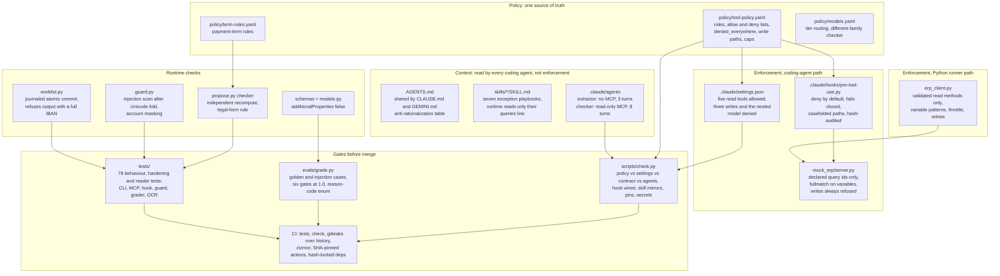
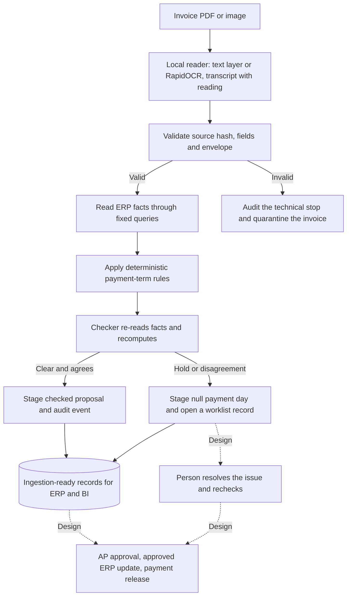
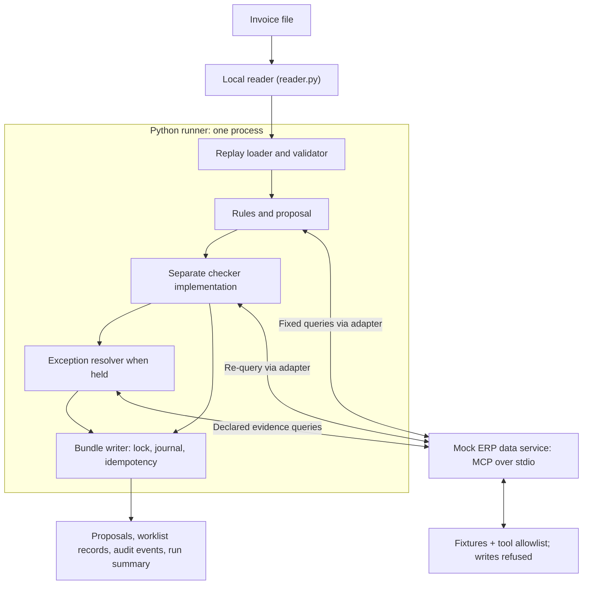
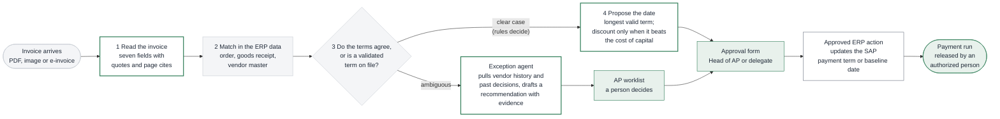

# Diagrams

Sources are the `.mmd` files in this folder. GitHub renders the blocks below directly. More diagrams (system context, containers, data model, clear-case and exception sequences, deployment, eval loop) live in [the architecture document](../04-architecture.md), and the trust boundary is in [the threat model](../06-threat-model.md).

## Harness: where each control sits

## Pipeline: one invoice through the sandbox

## Runtime: one process, one MCP subprocess

## Target process: where the agent fits in accounts payable

